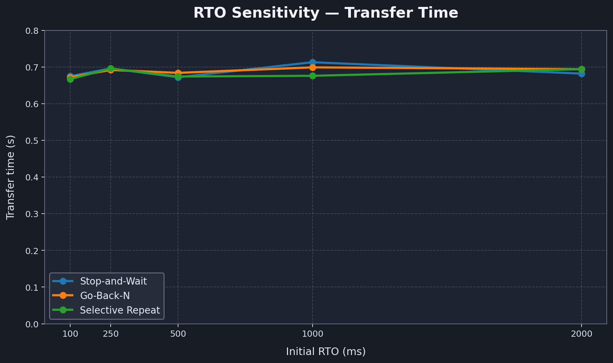
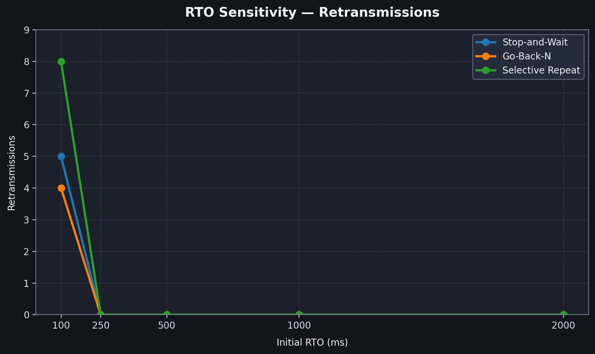
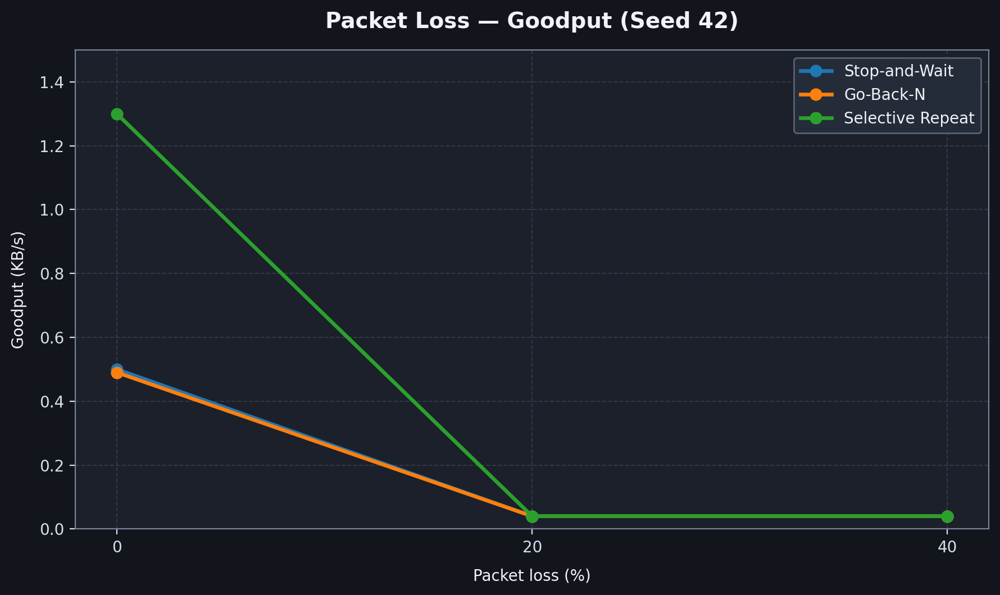
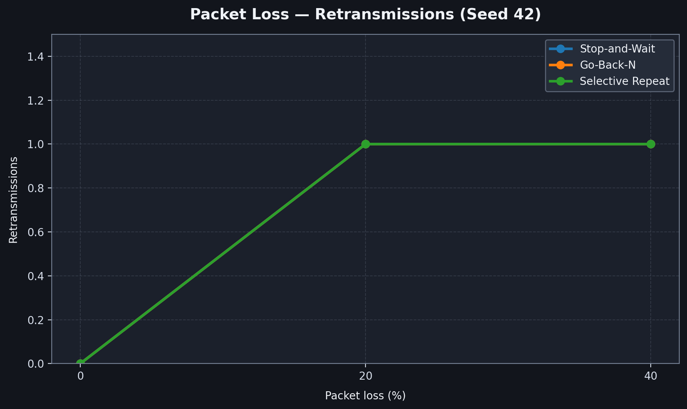
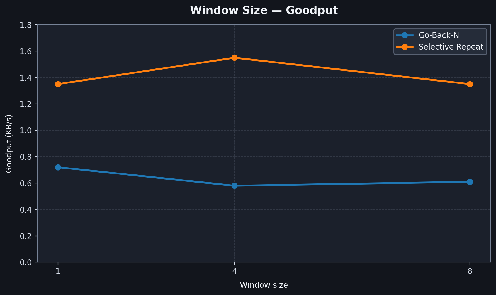
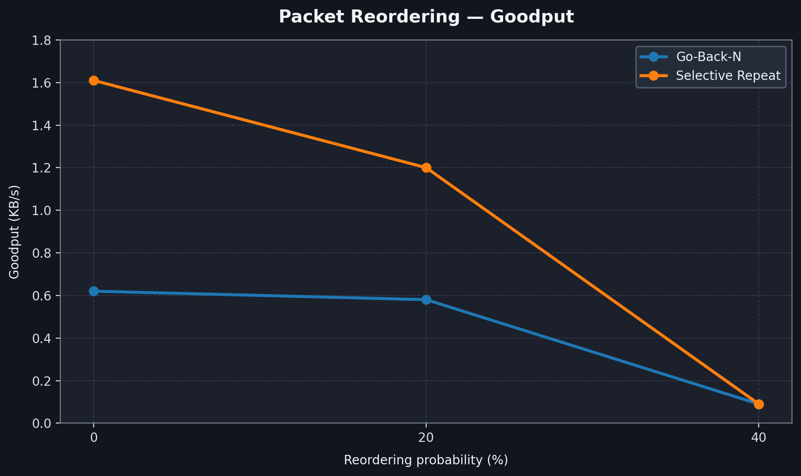

# Reliable UDP File Transfer — Experiment Results

## 1. Experimental Setup

The project evaluates three reliable UDP transport protocols:

- Stop-and-Wait (SAW)
- Go-Back-N (GBN)
- Selective Repeat (SR)

The channel emulator was used to introduce network conditions such as packet loss, duplication, corruption, reordering and delay.

File integrity was checked using SHA-256 hash comparison.

## 2. RTO Sensitivity Experiment

### Objective

To study how changing the initial retransmission timeout (RTO) affects transfer time and retransmissions in the three protocols.

### Configuration

| Parameter | Value |
|---|---:|
| Initial RTO values tested | 100, 250, 500, 1000, 2000 ms |
| Minimum RTO | 100 ms |
| Maximum RTO | 30000 ms |
| Emulator delay | 100 ms |
| Packet loss | 0% |
| Duplication | 0% |
| Corruption | 0% |
| Reordering | 0% |
| Random seed | 42 |

### Stop-and-Wait Results

| Initial RTO (ms) | Transfer time (s) | Packets sent | Retransmissions | Integrity |
|---:|---:|---:|---:|---|
| 100 | 0.675 | 8 | 5 | Passed |
| 250 | 0.696 | 3 | 0 | Passed |
| 500 | 0.672 | 3 | 0 | Passed |
| 1000 | 0.713 | 3 | 0 | Passed |
| 2000 | 0.682 | 3 | 0 | Passed |

### Go-Back-N Results

| Initial RTO (ms) | Transfer time (s) | Packets sent | Retransmissions | Integrity |
|---:|---:|---:|---:|---|
| 100 | 0.672 | 7 | 4 | Passed |
| 250 | 0.692 | 3 | 0 | Passed |
| 500 | 0.684 | 3 | 0 | Passed |
| 1000 | 0.699 | 3 | 0 | Passed |
| 2000 | 0.694 | 3 | 0 | Passed |

### Selective Repeat Results

| Initial RTO (ms) | Transfer time (s) | Packets sent | Retransmissions | Integrity |
|---:|---:|---:|---:|---|
| 100 | 0.667 | 11 | 8 | Passed |
| 250 | 0.696 | 3 | 0 | Passed |
| 500 | 0.674 | 3 | 0 | Passed |
| 1000 | 0.676 | 3 | 0 | Passed |
| 2000 | 0.694 | 3 | 0 | Passed |

### Observations

- With an initial RTO of 100 ms, all three protocols experienced retransmissions: Stop-and-Wait recorded 5, Go-Back-N recorded 4, and Selective Repeat recorded 8.
- At initial RTO values of 250 ms and above, all three protocols completed the displayed runs without retransmissions.
- All transfers completed successfully, and SHA-256 integrity verification passed for every displayed run.
- Transfer times remained relatively close across the tested RTO values because the input file was small and the emulator used a fixed 100 ms delay.
- The 100 ms initial RTO was too small for the tested network delay, resulting in unnecessary retransmissions.
- Increasing the initial RTO to 250 ms avoided retransmissions in these experiments.

These observations indicate that choosing an appropriate initial retransmission timeout is important for avoiding unnecessary retransmissions when network delay is significant. The results also show that all three protocols successfully maintained file integrity across the tested RTO settings.

### RTO Sensitivity — Transfer Time

### RTO Sensitivity — Retransmissions

## 3. Packet Loss Experiment

### Objective

To evaluate the reliability and performance of Stop-and-Wait, Go-Back-N, and Selective Repeat under different packet-loss conditions.

### Experimental Configuration

| Parameter | Value |
|---|---|
| Packet loss rates | 0%, 20%, 40% |
| Random seed (main trials) | 42 |
| Additional trial | 20% loss, seed 43 |
| Duplication | 0% |
| Corruption | 0% |
| Reordering | 0% |
| Emulator delay | 0 ms |
| Input file | test-input.txt |
| Integrity verification | SHA-256 |

### Main Results (Seed 42)

| Protocol | Packet Loss | Transfer Time (s) | Goodput (KB/s) | Packets Sent | Retransmissions | Integrity |
|---|---:|---:|---:|---:|---:|---|
| Stop-and-Wait | 0% | 0.083 | 0.50 | 3 | 0 | Passed |
| Stop-and-Wait | 20% | 1.081 | 0.04 | 4 | 1 | Passed |
| Stop-and-Wait | 40% | 1.094 | 0.04 | 4 | 1 | Passed |
| Go-Back-N | 0% | 0.085 | 0.49 | 3 | 0 | Passed |
| Go-Back-N | 20% | 1.099 | 0.04 | 4 | 1 | Passed |
| Go-Back-N | 40% | 1.092 | 0.04 | 4 | 1 | Passed |
| Selective Repeat | 0% | 0.032 | 1.30 | 3 | 0 | Passed |
| Selective Repeat | 20% | 1.039 | 0.04 | 4 | 1 | Passed |
| Selective Repeat | 40% | 1.035 | 0.04 | 4 | 1 | Passed |

### Additional Results (20% Packet Loss, Seed 43)

| Protocol | Transfer Time (s) | Goodput (KB/s) | Packets Sent | Retransmissions | Integrity |
|---|---:|---:|---:|---:|---|
| Stop-and-Wait | 2.095 | 0.02 | 5 | 2 | Passed |
| Go-Back-N | 2.109 | 0.02 | 5 | 2 | Passed |
| Selective Repeat | 2.030 | 0.02 | 5 | 2 | Passed |

### Packet Loss — Goodput

### Observations

- All three protocols successfully transferred the file under all tested packet-loss conditions.
- SHA-256 verification passed for every completed transfer, confirming that the received files matched the original files.
- At 0% packet loss, no retransmissions were required.
- At 20% and 40% packet loss in the main trials, retransmissions occurred to recover from dropped packets.
- The additional 20% loss trial with seed 43 resulted in two retransmissions for each protocol.
- Goodput decreased substantially under packet-loss conditions because of retransmissions and additional waiting time.
- These measurements are based on a small input file and should be interpreted as experimental observations rather than definitive performance rankings.

### Packet Loss — Retransmissions

## 4. Window Size Experiment

Go-Back-N and Selective Repeat were tested with window sizes of 1, 4 and 8 under 0% packet loss.

### Go-Back-N

| Window size | Transfer time (s) | Goodput (KB/s) | Retransmissions |
|---:|---:|---:|---:|
| 1 | 0.058 | 0.72 | 0 |
| 4 | 0.073 | 0.58 | 0 |
| 8 | 0.068 | 0.61 | 0 |

### Selective Repeat

| Window size | Transfer time (s) | Goodput (KB/s) | Retransmissions |
|---:|---:|---:|---:|
| 1 | 0.031 | 1.35 | 0 |
| 4 | 0.027 | 1.55 | 0 |
| 8 | 0.031 | 1.35 | 0 |

### Observations

- Selective Repeat achieved its highest measured goodput at window size 4.
- Go-Back-N achieved its highest measured goodput at window size 1 in these runs.
- No retransmissions occurred in the displayed window-size tests.
- Since the test file was small, these measurements should be treated as preliminary rather than proof that one window size is always optimal.

### Window Size — Goodput

## 5. Packet Reordering Experiment

Go-Back-N and Selective Repeat were tested at reordering probabilities of 0%, 20% and 40%.

### Go-Back-N

| Reordering probability | Transfer time (s) | Goodput (KB/s) | Retransmissions | Integrity |
|---:|---:|---:|---:|---|
| 0% | 0.068 | 0.62 | 0 | Passed |
| 20% | 0.072 | 0.58 | 0 | Passed |
| 40% | 0.462 | 0.09 | 0 | Passed |

### Selective Repeat

| Reordering probability | Transfer time (s) | Goodput (KB/s) | Retransmissions | Integrity |
|---:|---:|---:|---:|---|
| 0% | 0.026 | 1.61 | 0 | Passed |
| 20% | 0.035 | 1.20 | 0 | Passed |
| 40% | 0.461 | 0.09 | 0 | Passed |

### Observations

- At 40% reordering, the emulator selected packets for reordering and applied a 200 ms reorder delay.
- Transfer time increased substantially in the 40% runs.
- Both protocols completed the transfers without reported retransmissions.
- SHA-256 verification passed for all displayed runs.

### Packet Reordering — Goodput

## 6. Overall Notes

- All displayed experiment transfers passed file-integrity verification.
- The emulator helped evaluate protocol behaviour under different network conditions.
- The experiments demonstrate the importance of retransmission timeout selection, sliding-window size and packet ordering.
- The experimental results are presented using tables and graphs to illustrate the effects of RTO, packet loss, window size and packet reordering on protocol performance.
